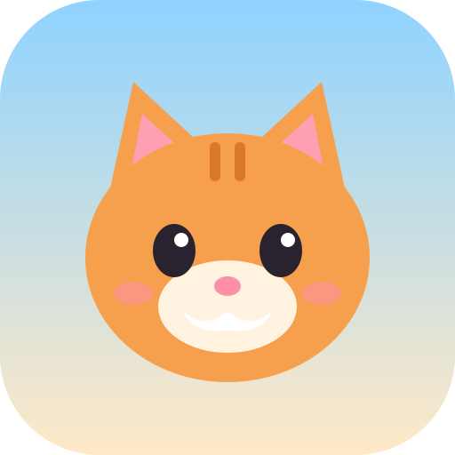
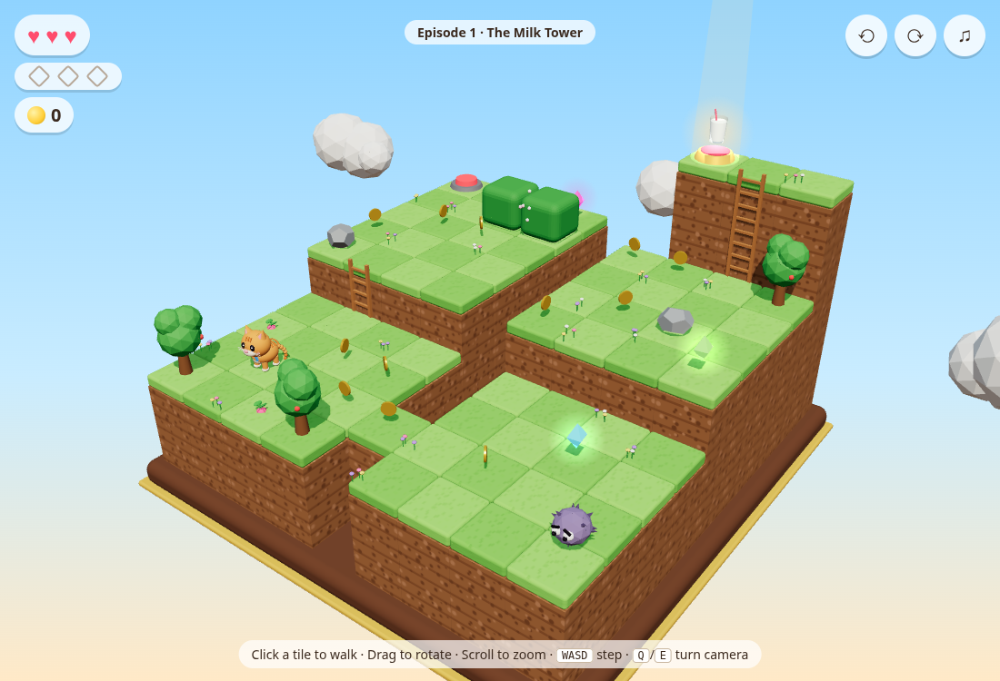
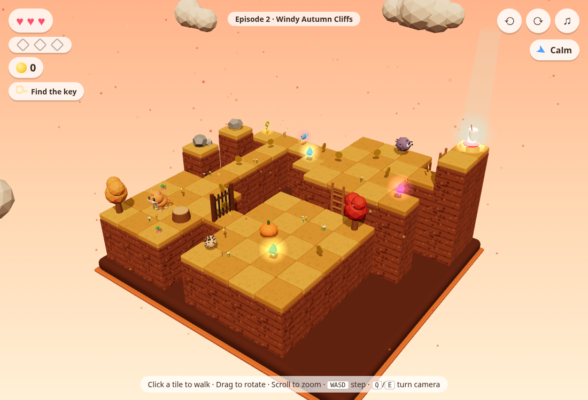
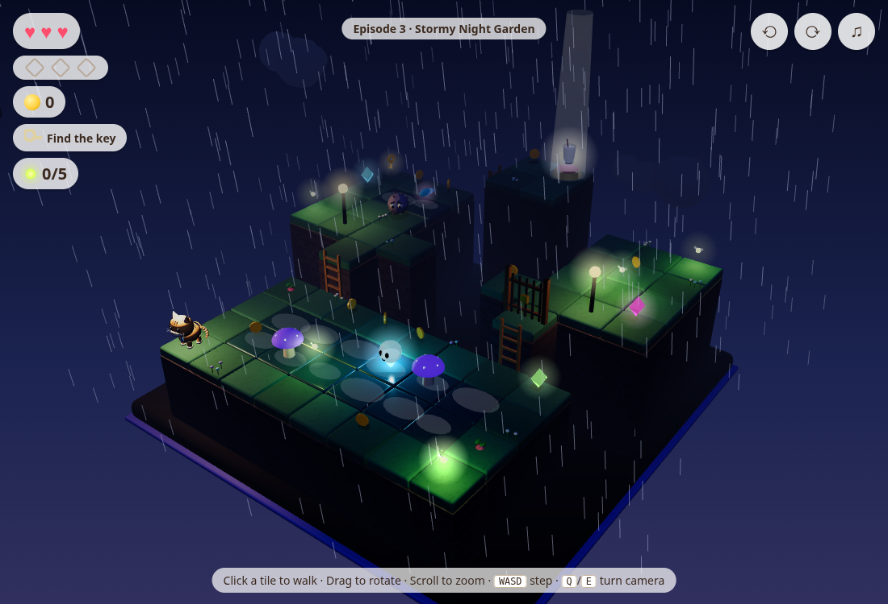
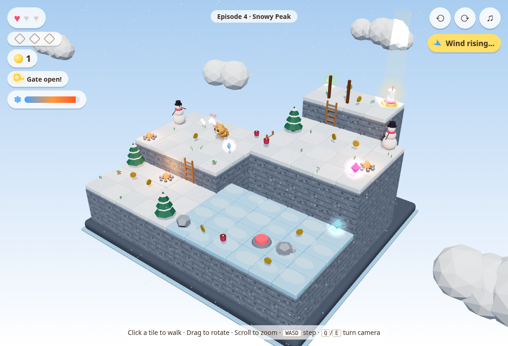
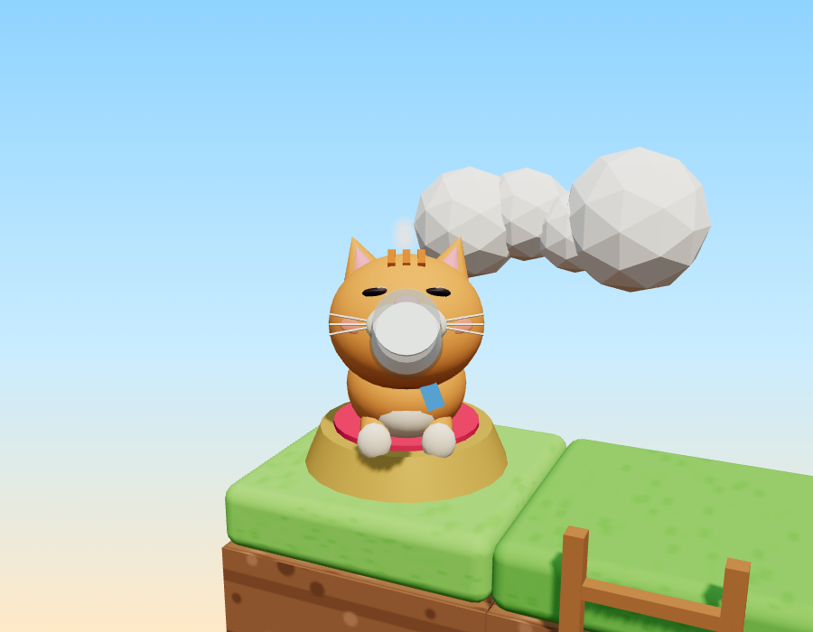

<div align="center">



# Babycat Treasure

**A cozy 3D diorama puzzle adventure, built with three.js.**

Guide **Mochi the kitten** through four tiny floating worlds. Collect the hidden gems,
outsmart the weather, and earn the best reward of all: a glass of milk.


### [▶ Play it in your browser](https://alejandroaguil-byte.github.io/babycat-treasure/)

Works on desktop and phones, and can be installed as an app for offline play.



</div>

## Contents

- [Highlights](#highlights)
- [The worlds](#the-worlds)
- [How to play](#how-to-play)
- [Run it locally](#run-it-locally)
- [How it works](#how-it-works)
- [Project structure](#project-structure)

## Highlights

- **Rotate the world to find secrets.** Every level is a small handcrafted diorama. Some gems
  only show up when you look from the right angle.
- **Kittens can't jump.** You get around with ladders, switches, rising bridges, keys and gates.
- **Weather that changes how you play.** Wind gusts push you off cliffs, storms turn off the
  lights, and the ice won't let you stop.
- **Everything is generated in code.** The models are built from three.js primitives, and the
  music, ambience and sound effects are synthesized with the Web Audio API. The game ships no
  image or audio files.
- **Looks like a real miniature.** A tilt-shift blur, bloom on glowing things and cartoon
  outlines make the dioramas feel like tiny physical models.
- **Plays anywhere.** Touch controls, an installable app that works offline (PWA), and graphics
  quality that adapts automatically when a phone struggles.
- **Every level is checked by tests.** Automated checks prove each level can be finished and
  has no spot where the kitten gets stuck.

## Story and characters

Lord Fluff, the Dust Bunny King, hates anything clean and milky. His dust storm blew Grandma
Hazel's four magic milk glasses across the floating islands, and Mochi sets off to bring them
back, making friends along the way. The characters talk to each other in short scenes, each
with their own voice: real speech through the browser's text-to-speech, or a cute procedural
"chirp" voice that works offline.

| | Character | Role in the game |
| :-: | --- | --- |
| 🐱 | **Mochi** | The kitten hero. Can't jump, loves milk |
| 🐦 | **Pip**, sparrow | Rides along in every world. Tap his button and he flies to the nearest gem (3 hints per level) |
| 🐢 | **Bruno**, tortoise | World 2. Follows you and blocks the wind when you stand right behind his shell. Mochi hops onto his shell to get past him, and gusts can't move her up there |
| 🦋 | **Luna**, glow moth | World 3. Lights up the night; her flash freezes nearby wisps |
| 🐧 | **Pom**, penguin | World 4. Stand still next to him for a warm penguin hug |
| 🦉 | **Grandma Hazel** | Runs the Cozy Creamery and narrates the adventure |
| 👑 | **Lord Fluff** | The sneezy villain behind the dust storm |

**Languages:** the whole game, dialogue included, is available in English and Spanish. It
starts in your device's language and can be switched from the start screen or Settings.

## The worlds

Each world keeps the mechanics from the ones before it and adds new weather, characters and
items, so the difficulty climbs steadily.

| | World | Weather & terrain | New characters | New items |
| :-: | --- | --- | --- | --- |
| 1 | **The Milk Tower** | Sunny meadow | Dust bunny | Gems, coins, yarn sprouts, switch bridge |
| 2 | **Windy Autumn Cliffs** | Wind gusts push Mochi a tile, or off the edge. Rocks upwind give shelter | Hedgehog (yarn only stuns it) | Key & gate, fish treat (+1 heart) |
| 3 | **Stormy Night Garden** | Darkness (Mochi carries a lantern), lightning, rain, slippery wet tiles | Will-o'-wisp that chases you | 5 fireflies that light up the way |
| 4 | **Snowy Peak** | Ice you slide across until something stops you, blizzards, a cold meter | Snowmen rolling snowballs | Hot cocoa, campfires |

<table>
  <tr>
    <td></td>
    <td></td>
  </tr>
  <tr>
    <td align="center"><b>Windy Autumn Cliffs</b></td>
    <td align="center"><b>Stormy Night Garden</b></td>
  </tr>
  <tr>
    <td></td>
    <td></td>
  </tr>
  <tr>
    <td align="center"><b>Snowy Peak</b></td>
    <td align="center"><b>The reward</b></td>
  </tr>
</table>

## How to play

| Action | Mouse / touch | Keyboard |
| --- | --- | --- |
| Walk to a tile | Click or tap it | |
| Step one tile | | `WASD` / arrow keys (relative to the camera) |
| Rotate the world | Drag | `Q` / `E` |
| Zoom | Scroll / pinch | |
| Throw a yarn ball | Click an enemy, or the **Throw!** button on touch | `Space` |
| Pause / resume | ❚❚ button | `Esc` / `P` |
| Restart the level | Pause menu | `R` |
| Mute | ♫ button | `M` |

**Tips**

- Watch the wind indicator. When it says *Wind rising...*, get behind a rock.
- On ice you keep sliding until something stops you, so plan your route before you step.
- In the snow, stay close to campfires and grab hot cocoa before the cold meter runs out.
- Your progress, best gem count and settings (volume, graphics, vibration) are saved in the browser.
- On a phone, use your browser's *Install app* / *Add to Home screen* to play full screen, even offline.

## Run it locally

You need [Node.js](https://nodejs.org/) 20.19+ or 22.12+.

```bash
npm install
npm run dev        # http://localhost:5173
```

| Script | What it does |
| --- | --- |
| `npm run dev` | Development server with hot reload |
| `npm run build` | Production build in `dist/` (relative paths, so it works on any static host) |
| `npm run preview` | Serve the production build locally |
| `npm test` | Grid logic tests, plus solvability and no-soft-lock checks for every level |

To play on your phone from your local network or tailnet, run
`npx vite --host 0.0.0.0` and open the printed network URL.

Every [release](../../releases) also includes a ready-to-serve zip of the build.

**Continuous integration:** every push to `main` runs the tests and the production build on
GitHub Actions. When the repository is public, the same workflow publishes the game to
GitHub Pages.

## How it works

**Levels are data.** Each world is a small JS module: a height map (`'2222..444'`), optional
surface rows (`w` wet, `i` ice), and lists of ladders, bridges, items, enemies and weather.

```js
export default {
  title: 'Snowy Peak',
  theme: 'snow',
  map: ['......4444.', /* ... */],
  surface: ['...........', /* ... */ '.....iiiiii'],
  ladders: [{ a: [3, 7], b: [3, 6] }],
  bridges: [{ x: 5, z: 4, h: 2, trigger: 'switch' }],
  weather: { snow: true, cold: { drain: 3.2 }, wind: { dir: [1, 0], blizzard: true } },
};
```

**The rules are pure functions.** `src/game/grid.js` has no three.js in it. It decides where
the kitten can step, how far she slides on wet or icy tiles, where a gust pushes her, and the
shortest path to a clicked tile. Because it's pure, it runs in Node, and the tests use it to
prove every level can be completed without getting stuck.

**Rendering, weather and enemies sit on top.** The world builder turns level data into
meshes. The weather system runs the wind cycle (calm → warning → gust) and the rain, snow,
leaf and lightning effects. Each enemy type has its own behavior: patrolling, chasing with
pathfinding, or rolling snowballs down a lane.

## Project structure

| Path | Purpose |
| --- | --- |
| `src/game/levels/` | Level definitions, one module per world |
| `src/game/grid.js` | Pure rules: walkability, ladders, bridges, gates, slides, wind, pathfinding |
| `src/world/` | three.js models, per-world themes and level construction |
| `src/render/` | Post-processing (tilt-shift, bloom, sky pass), outlines, adaptive quality |
| `src/ui/` | Persisted player settings and haptics |
| `src/story/` | Characters, voices (TTS + chirps), dialogue player and the story script |
| `src/i18n/` | English and Spanish dictionaries |
| `public/` | PWA manifest, service worker and app icons |
| `src/mechanics/` | Weather cycle and particles, enemy behaviors, companion follow and hint logic |
| `src/audio.js` | Procedural music (one song per world), ambience and sound effects |
| `src/effects.js` | Particles: sparkles, dust, confetti, rings |
| `src/main.js` | Game loop, input, camera, progression and cutscenes |
| `test/` | `node:test` suite |

<div align="center">

Made with 🧡 for Mochi.

</div>
